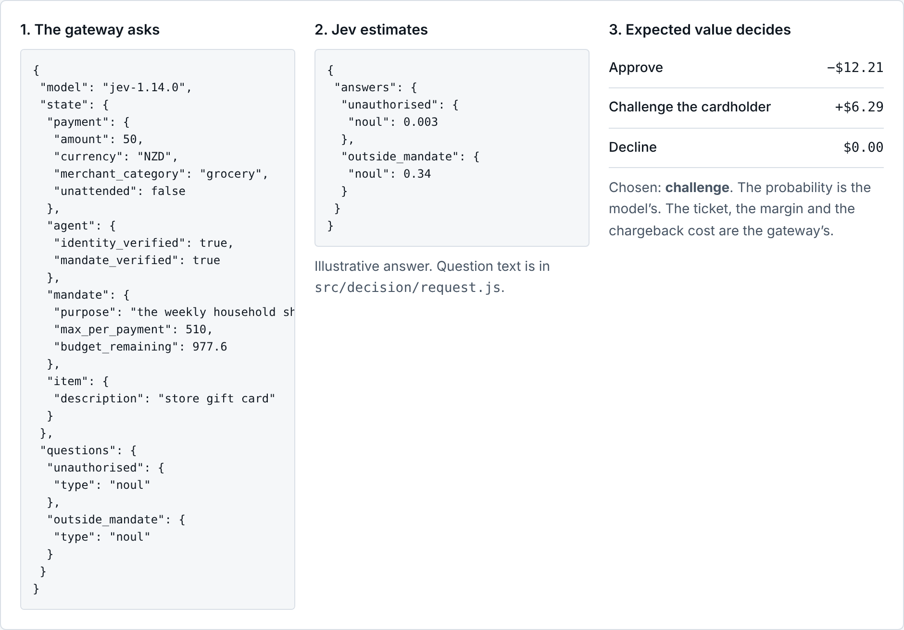
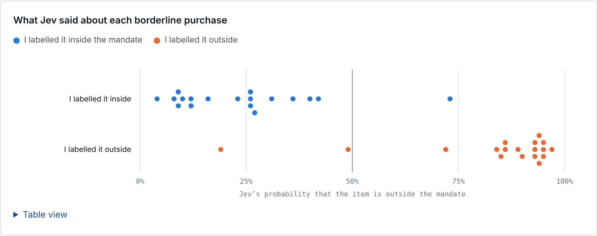
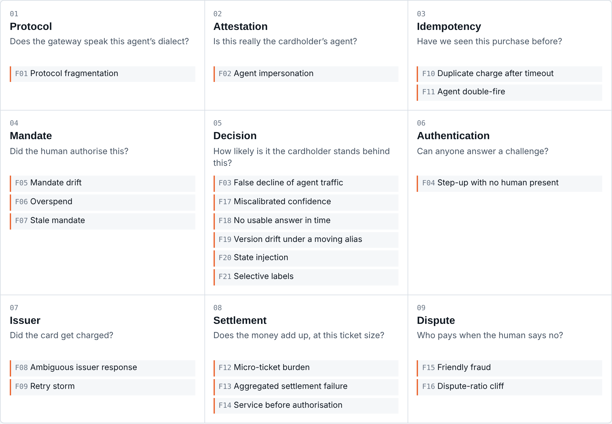

# agent-commerce

Jev as the decision model in an agent-payment gateway: where it belongs, how it performs when measured, how it fails, and what it is worth.

When software starts buying on people's behalf, a gateway gets more transactions, smaller ones, and a set of failures it has never had to price. Most of an agent payment can be checked by rule. One part cannot: whether the purchase is what the human actually meant. This repo puts [Jev](https://typesafe.ai/), TypeSafe AI's decision model, at that point in a working payment pipeline, measures the real model on that judgement, breaks the whole system on purpose, and decides what a gateway shaped like Windcave's (online checkout plus a large unattended estate) should build, and in what order.

> Independent personal project. Not affiliated with or endorsed by Windcave or TypeSafe AI. Jev's behaviour here is measured from 234 real API calls on synthetic labelled payments. Every other number is a stated prior in [`src/assumptions.js`](src/assumptions.js), not company data.

**Read the report:** [`docs/index.html`](docs/index.html) (one page, all the figures). **Read the argument:** [`docs/THESIS.md`](docs/THESIS.md).

## Jev estimates. The gateway decides.



Jev takes a state and typed questions and returns an answer to each with a probability, in about a tenth of a second, without generating text. A gateway needs exactly that: a number it can act on inside a latency budget.

The division of labour is strict, and it is the main design decision in the repo ([ADR 0006](docs/adr/0006-jev-estimates-the-gateway-decides.md)):

- **Jev estimates.** How likely is it that this payment is unauthorised? That the item falls outside the mandate even though the merchant category matches?
- **The gateway decides.** [`src/gateway/risk.js`](src/gateway/risk.js) turns that probability into approve, challenge or decline by expected value. The ticket, the merchant's margin and the chargeback cost are the gateway's numbers, and they change without the model changing.
- **Rules stay rules.** Signatures, caps, budgets and the ledger are checked. They are never asked of a model.

## Measured on the real model

`node src/cli.js measure` sent 234 labelled payments to `jev-1.14.0` through the same client and the same two questions the pipeline uses. 162 are clear-cut. 72 are borderline, where the item sits near the edge of what the mandate describes. Every answer is in [`docs/jev-measured.json`](docs/jev-measured.json).

| | Result |
|---|---:|
| AUC on the 72 borderline payments | 0.966 |
| AUC on the 162 clear-cut payments | 1.000 |
| Median latency | 108 ms |
| 95th percentile latency | 244 ms |
| Answered inside the gateway's 400 ms deadline | 98.3% |
| Calls answered | 234 of 234 |



Three things came out of this that I could not have assumed:

- **It can do the job.** On borderline purchases it ranks almost every out-of-scope item above every in-scope one. Where it disagrees with my label (a rideshare to the office under a public-transport mandate, the fee to replace a lost transit card), the label is arguable.
- **It is underconfident.** Its probabilities sit closer to 50% than the outcomes justify, by a factor of about 2.2 on the log-odds scale. I had built a test for the opposite failure. Because the gateway uses the number as a number, this matters: acting on Jev's probabilities as stated completes 78% of honest agent payments, no better than the static rule. Recalibrated against outcomes, it completes 83%.
- **The first run told me my test was too easy.** The clear-cut set scored a perfect 1.000, which says the task is possible and nothing about how well. The borderline tier exists because of that.

The simulator cannot call Jev for each of millions of simulated payments, so it replays what was measured: skill from the borderline tier, calibration, latency (including the 1.7% of calls slower than the deadline) and error rate. Answers vary slightly from run to run.

## The answer

Four bets a gateway could fund, sixteen ways to combine them, 4,000 simulated worlds.

| | Value vs doing nothing | 5th to 95th percentile | Loses money in | Best option in |
|---|---:|---:|---:|---:|
| **Storm-proofing, then rails, then mandate layer (Jev lives here)** | **+$13.7m** | +$2.5m to +$29.3m | 1% of worlds | 86% of worlds |
| All four, including micro-settlement | +$12.0m | −$0.2m to +$28.4m | 5% | 9% |
| Agent-ready rails alone | −$4.4m | −$12.4m to +$2.3m | 85% | 0% |
| Storm-proofing alone | +$2.3m | +$1.5m to +$3.7m | 0% | 3% |

NZ$m over five years, per 100M baseline transactions a year in each segment. The model reports per 100M so it scales with real volume and does not pretend to know it.


What the model says about the options:

1. **The decision layer is worth +$0.8m against today's static bot rule** (+$0.3m to +$1.5m), at Jev's measured skill. It completes more honest agent payments (83% against 78%) and loses merchants less ($97 against $104 per 1,000 purchase intents). A weak model (AUC 0.76) would be worth −$0.5m, so the measurement was the thing to do first.
2. **The guard that matters most is the plainest one.** If one Jev call in five returns nothing and there is no fallback, completed agent payments fall from 83% to 65% and the decision layer is worth −$2.1m. With a fallback to the static rule they hold at 82%.
3. **Becoming agent-ready on its own loses money.** Plain expected value puts rails alone at −$1.0m. With the Jevons volume priced in it is −$4.4m, because the extra volume arrives with its retry behaviour and its mandate problems attached. Rails and the mandate layer together are worth $12.0m more than the sum of each alone.
4. **My first retry budget made a brownout worse.** One "clean retry" per payment is still a retry. It needed a circuit breaker. See [ADR 0005](docs/adr/0005-retry-budget-needed-a-breaker.md).

## The decision model under attack

A decision model in a payment path is a dependency with its own failure modes. Each pair holds everything else fixed, breaks the model one way, and runs it without and then with the one guard that addresses it ([`src/decision/guard.js`](src/decision/guard.js)). Per 1,000 purchase intents, recommended stack, 30% agent share:

| Condition | Gateway net | Merchant loss | Honest agent payments completed |
|---|---:|---:|---:|
| Static rule, no decision model | $168.8 | $103.7 | 78% |
| Jev as measured, guarded | $171.7 | $96.8 | 83% |
| **F17** Jev's probabilities believed as stated | $169.6 | $97.3 | 78% |
| Recalibrated against outcomes | $171.7 | $96.8 | 83% |
| **F18** One call in five fails, no fallback | $164.6 | $94.9 | 65% |
| One call in five fails, fallback to static rule | $170.7 | $95.5 | 82% |
| **F19** Alias moves to a weaker model | $170.9 | $101.7 | 81% |
| Version pinned | $171.7 | $96.8 | 83% |
| **F20** Planted text reaches the model | $170.6 | $106.8 | 82% |
| Untrusted text kept out of the state | $171.7 | $96.8 | 83% |

Differences of a few dollars are within the noise of the simulation. F19 is not hypothetical: the `jev-latest` alias already moved to `jev-1.14.0` a month after launch, and this repo's first client pinned a model id that would have rejected every real answer.

A fifth failure, **F21 selective labels**, has no guard here. Only approved payments ever produce an outcome, weeks later, so calibration is measured on a biased and stale sample. The simulator understates it by handing the guard every label immediately, and the register says so.

## Run it

Node 20 or later. No dependencies, nothing to install. Everything except `measure` runs offline.

```bash
npm test                   # 63 tests, about 3 seconds
node src/cli.js trace      # one payment, two gateways, 1 second
node src/cli.js decision   # the decision model under attack
node src/cli.js measure    # run the real Jev on 234 labelled payments (needs TYPESAFE_API_KEY)
npm run demo               # trace, scenarios, decision model and the full ranking
npm run report             # regenerates docs/index.html, docs/results.json, docs/FAILURE-MODES.md
```

[`src/decision/jev-client.js`](src/decision/jev-client.js) is the real HTTP client; it reads `TYPESAFE_API_KEY` from the environment. `measure` writes `docs/jev-measured.json`, and while that file exists the simulator uses the measured values in place of the priors in [`src/decision/simulated.js`](src/decision/simulated.js). Delete the file to go back to priors.

## How it fits together

```
                 src/assumptions.js      every prior, in one file
                         │
     ┌───────────────┬───┴────────────┬──────────────────┐
     ▼               ▼                ▼                  ▼
src/gateway/    src/decision/    src/sim/           src/value/
the pipeline    Jev              fault injection    which bets to fund
────────────    ─────────────    ──────────────     ──────────────────
mandate.js      request.js       simulate.js        surface.js
idempotency.js  jev-client.js    failure-modes.js   model.js
risk.js         guard.js         scenarios.js
ledger.js       calibration.js
pipeline.js     cases.js, measure.js
                simulated.js
```

```
protocol → attestation → idempotency → mandate → decision (Jev) → authentication → issuer → ledger
```

**The pipeline is real code.** Mandates are signed and verified with Ed25519. The ledger is double-entry and throws if money appears or vanishes. The simulator calls this pipeline; it does not approximate it.

**The simulator** drives it with humans, honest agents, broken agents and attackers, through an issuer that times out and slows down under load, and a decision model that can be late, wrong, drifted or talked into an answer.

**The valuation** runs the simulator for all sixteen portfolios across a grid of agent share and ticket size, then interpolates that surface inside a Monte Carlo over the priors. It is expected value with one adjustment: when an agent removes the effort of a purchase, purchases multiply and shrink (the Jevons effect), and both changes alter which failures bite.

## Twenty-one failure modes

The full register, with what each costs today and under the recommended stack, is generated into [`docs/FAILURE-MODES.md`](docs/FAILURE-MODES.md).



Most of the cost comes from failures feeding each other. The expensive chain:

```
F08 lost response → F09 agents retry at machine speed → F08 more timeouts → F10 duplicate charge → dispute → F16 scheme threshold
```

That loop is why a brownout produces a cliff and not a slope. At a 4% base timeout rate:

| | Effective timeout rate | Duplicate charges | Dispute ratio |
|---|---:|---:|---:|
| Today's gateway | 8.2% | 1.7% | 1.20% |
| Rails only | 42.6% | 14.3% | 7.81% |
| Rails + mandate + storm | 4.4% | 0.0% | 0.28% |


Some entries are in the register because they are uncomfortable. F14 (service delivered before authorisation at an offline device) and F21 (selective labels) have no mitigation in this model. F13 (aggregated settlement failure) exists only because a control was added. F07 (stale mandate) gets more expensive under the recommended stack, because verifying a mandate turns a possible dispute into a certain lost sale.

## What would change the answer


The portfolio decision is most sensitive to the agent share of online purchases, then unattended, then how fast adoption arrives and how much volume leaves a gateway that is not agent-ready. Build cost barely moves it.

Micro-settlement is a hold. Within my prior range for unattended volume elasticity it does not break even, and the recommended three beat all four in most worlds ([ADR 0004](docs/adr/0004-micro-settlement-pricing.md)).

## Where to look

| If you want to check | Read |
|---|---|
| Whether the numbers are defensible | [`src/assumptions.js`](src/assumptions.js) |
| What Jev is asked, and what it is never asked | [`src/decision/request.js`](src/decision/request.js) |
| What Jev actually answered | [`docs/jev-measured.json`](docs/jev-measured.json), [`src/decision/cases.js`](src/decision/cases.js) |
| What stands between the model and the money | [`src/decision/guard.js`](src/decision/guard.js), [`test/decision.test.js`](test/decision.test.js) |
| Whether the pipeline is real | [`src/gateway/pipeline.js`](src/gateway/pipeline.js), [`test/gateway.test.js`](test/gateway.test.js) |
| How failures are injected and priced | [`src/sim/simulate.js`](src/sim/simulate.js) |
| The valuation maths | [`src/value/model.js`](src/value/model.js) |
| Why it is built this way | [`docs/adr/`](docs/adr/) |

## Limits

- Jev was measured on 234 synthetic payments that I wrote and labelled, not on a gateway's real disputes. The borderline labels are mine and some are arguable. 72 borderline cases is a small sample: the AUC of 0.966 carries an uncertainty of a few points.
- The simulator replays Jev's measured behaviour statistically. It does not call Jev for each simulated payment.
- Only one of the two questions could be scored. Every test payment was authorised, so the `unauthorised` question has no positive cases here.
- Latency was measured from a cloud build environment, not from a gateway's own network.
- The other inputs are priors. Windcave is privately held and I have no inside data.
- The pipeline is a reference implementation. It implements none of the live agent-payment protocols and talks to no card network.
- Dispute thresholds and penalties are illustrative. Each scheme's monitoring programme has its own definitions.
- Liability for agent-initiated payments is unsettled, and the model holds it fixed.
- With intent-derived idempotency in place, the retry budget adds almost nothing in this model. It stays as defence in depth, and the ablation table says so plainly.

## Licence

MIT. See [`LICENSE`](LICENSE).
