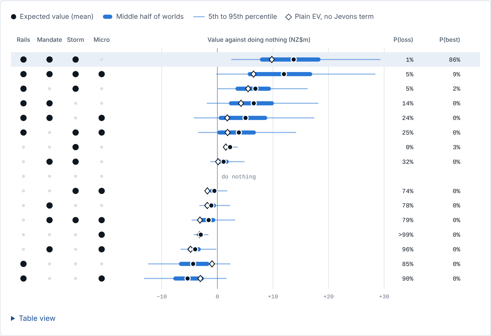
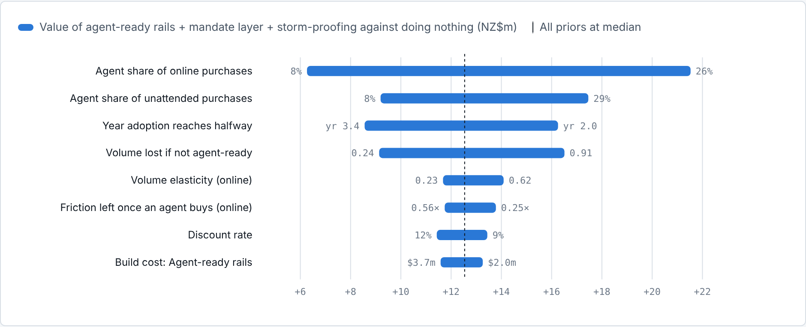

# agent-commerce

Jev as the decision model in an agent-payment gateway: where it belongs, how it fails, and what it is worth.

When software starts buying on people's behalf, a gateway gets more transactions, smaller ones, and a set of failures it has never had to price. Most of an agent payment can be checked by rule. One part cannot: whether the purchase is what the human actually meant. This repo puts [Jev](https://typesafe.ai/), TypeSafe AI's decision model, at that point in a working payment pipeline, breaks the whole system on purpose, and decides what a gateway shaped like Windcave's (online checkout plus a large unattended estate) should build, and in what order.

> Independent personal project. Not affiliated with or endorsed by Windcave or TypeSafe AI. Every number is a stated prior in [`src/assumptions.js`](src/assumptions.js), not company data. The decision model in every simulation is a stand-in whose quality is a dial; nothing here measures Jev itself.

**Read the report:** [`docs/index.html`](docs/index.html) (one page, all the figures). **Read the argument:** [`docs/THESIS.md`](docs/THESIS.md).

## Jev estimates. The gateway decides.


Jev takes a state and typed questions and returns an answer to each with a probability, in a few hundred milliseconds, without generating text. A gateway needs exactly that: a number it can act on inside a latency budget.

The division of labour is strict, and it is the main design decision in the repo ([ADR 0006](docs/adr/0006-jev-estimates-the-gateway-decides.md)):

- **Jev estimates.** How likely is it that this payment is unauthorised? That the item falls outside the mandate even though the merchant category matches?
- **The gateway decides.** [`src/gateway/risk.js`](src/gateway/risk.js) turns that probability into approve, challenge or decline by expected value. The ticket, the merchant's margin and the chargeback cost are the gateway's numbers, and they change without the model changing.
- **Rules stay rules.** Signatures, caps, budgets and the ledger are checked. They are never asked of a model.

## The answer

Four bets a gateway could fund, sixteen ways to combine them, 4,000 simulated worlds.

| | Value vs doing nothing | 5th to 95th percentile | Loses money in | Best option in |
|---|---:|---:|---:|---:|
| **Storm-proofing, then rails, then mandate layer (Jev lives here)** | **+$13.9m** | +$2.7m to +$29.3m | 1% of worlds | 78% of worlds |
| All four, including micro-settlement | +$12.9m | +$0.6m to +$29.5m | 4% | 18% |
| Agent-ready rails alone | −$4.4m | −$12.4m to +$2.3m | 85% | 0% |
| Storm-proofing alone | +$2.3m | +$1.5m to +$3.7m | 0% | 3% |

NZ$m over five years, per 100M baseline transactions a year in each segment. The model reports per 100M so it scales with real volume and does not pretend to know it.



Four things the model said that I did not expect going in:

1. **The decision model earns its place by what it stops blocking.** Against today's static bot rule it is worth +$0.9m (+$0.3m to +$1.7m). Almost all of that is honest agent payments that are no longer declined: completion rises from 78% to 84%. On merchant losses it only beats the static rule above an AUC of about 0.97. At these base rates a calibrated model approves nearly everything, and that is the correct answer.
2. **The guard that matters most is the plainest one.** If one Jev call in five returns nothing and there is no fallback, completed agent payments fall from 84% to 65% and the decision layer is worth −$2.5m. With a fallback to the static rule they hold at 83%.
3. **Becoming agent-ready on its own loses money.** Plain expected value puts rails alone at −$1.0m. With the Jevons volume priced in it is −$4.4m, because the extra volume arrives with its retry behaviour and its mandate problems attached. Rails and the mandate layer together are worth $11.0m more than the sum of each alone.
4. **My first retry budget made a brownout worse.** One "clean retry" per payment is still a retry. It needed a circuit breaker. See [ADR 0005](docs/adr/0005-retry-budget-needed-a-breaker.md).

## The decision model under attack

A decision model in a payment path is a dependency with its own failure modes. Each pair holds everything else fixed, breaks the model one way, and runs it without and then with the one guard that addresses it ([`src/decision/guard.js`](src/decision/guard.js)). Per 1,000 purchase intents, recommended stack, 30% agent share:

| Condition | Gateway net | Merchant loss | Honest agent payments completed |
|---|---:|---:|---:|
| Static rule, no decision model | $168.9 | $102.7 | 78% |
| Jev as assumed, guarded | $171.5 | $103.8 | 84% |
| **F17** Overconfident, believed as stated | $171.3 | $110.2 | 84% |
| Overconfident, recalibrated | $171.5 | $100.7 | 84% |
| **F18** One call in five fails, no fallback | $164.1 | $103.0 | 65% |
| One call in five fails, fallback to static rule | $170.7 | $107.9 | 83% |
| **F19** Alias moves to a weaker model | $170.9 | $110.4 | 84% |
| Version pinned | $171.5 | $103.8 | 84% |
| **F20** Planted text reaches the model | $171.4 | $109.2 | 84% |
| Untrusted text kept out of the state | $171.5 | $103.8 | 84% |

A fifth failure, **F21 selective labels**, has no guard here. Only approved payments ever produce an outcome, weeks later, so calibration is measured on a biased and stale sample. The simulator understates it by handing the guard every label immediately, and the register says so.

## Run it

Node 20 or later. No dependencies, no network, nothing to install.

```bash
npm test                   # 57 tests, about 3 seconds
node src/cli.js trace      # one payment, two gateways, 1 second
node src/cli.js decision   # the decision model under attack, about 15 seconds
npm run demo               # everything above plus the full ranking
npm run report             # regenerates docs/index.html, docs/results.json, docs/FAILURE-MODES.md
```

The simulator and the tests use [`src/decision/simulated.js`](src/decision/simulated.js), a stand-in with dials for skill, calibration, latency, outage, drift and injection. [`src/decision/jev-client.js`](src/decision/jev-client.js) is the real HTTP client with the same interface; it reads `TYPESAFE_API_KEY` from the environment. It follows public quickstart material and has not been run against the live API.

## How it fits together

```
                 src/assumptions.js      every prior, in one file
                         │
     ┌───────────────┬───┴────────────┬──────────────────┐
     ▼               ▼                ▼                  ▼
src/gateway/    src/decision/    src/sim/           src/value/
the pipeline    Jev              fault injection    which bets to fund
────────────    ─────────────    ──────────────     ──────────────────
mandate.js      request.js       simulate.js        surface.js
idempotency.js  jev-client.js    failure-modes.js   model.js
risk.js         simulated.js     scenarios.js
ledger.js       guard.js
pipeline.js     calibration.js
```

```
protocol → attestation → idempotency → mandate → decision (Jev) → authentication → issuer → ledger
```

**The pipeline is real code.** Mandates are signed and verified with Ed25519. The ledger is double-entry and throws if money appears or vanishes. The simulator calls this pipeline; it does not approximate it.

**The simulator** drives it with humans, honest agents, broken agents and attackers, through an issuer that times out and slows down under load, and a decision model that can be late, wrong, drifted or talked into an answer.

**The valuation** runs the simulator for all sixteen portfolios across a grid of agent share and ticket size, then interpolates that surface inside a Monte Carlo over the priors. It is expected value with one adjustment: when an agent removes the effort of a purchase, purchases multiply and shrink (the Jevons effect), and both changes alter which failures bite.

## Twenty-one failure modes

The full register, with what each costs today and under the recommended stack, is generated into [`docs/FAILURE-MODES.md`](docs/FAILURE-MODES.md).


Most of the cost comes from failures feeding each other. The expensive chain:

```
F08 lost response → F09 agents retry at machine speed → F08 more timeouts → F10 duplicate charge → dispute → F16 scheme threshold
```

That loop is why a brownout produces a cliff and not a slope. At a 4% base timeout rate:

| | Effective timeout rate | Duplicate charges | Dispute ratio |
|---|---:|---:|---:|
| Today's gateway | 8.2% | 1.7% | 1.20% |
| Rails only | 42.6% | 14.3% | 7.81% |
| Rails + mandate + storm | 4.4% | 0.0% | 0.29% |


Some entries are in the register because they are uncomfortable. F14 (service delivered before authorisation at an offline device) and F21 (selective labels) have no mitigation in this model. F13 (aggregated settlement failure) exists only because a control was added. F07 (stale mandate) gets more expensive under the recommended stack, because verifying a mandate turns a possible dispute into a certain lost sale.

## What would change the answer



The portfolio decision is most sensitive to the agent share of online purchases, then unattended, then how fast adoption arrives and how much volume leaves a gateway that is not agent-ready. Build cost barely moves it.

For Jev specifically, two numbers decide whether it earns its place, and both can be measured in shadow mode before it decides a single live payment: its AUC on this gateway's own disputes, and how often it answers inside the deadline.

Micro-settlement is a hold. It pays once unattended volume elasticity passes about 1.04, against my prior of 0.6 ([ADR 0004](docs/adr/0004-micro-settlement-pricing.md)).

## Where to look

| If you want to check | Read |
|---|---|
| Whether the numbers are defensible | [`src/assumptions.js`](src/assumptions.js) |
| What Jev is asked, and what it is never asked | [`src/decision/request.js`](src/decision/request.js) |
| What stands between the model and the money | [`src/decision/guard.js`](src/decision/guard.js), [`test/decision.test.js`](test/decision.test.js) |
| Whether the pipeline is real | [`src/gateway/pipeline.js`](src/gateway/pipeline.js), [`test/gateway.test.js`](test/gateway.test.js) |
| How failures are injected and priced | [`src/sim/simulate.js`](src/sim/simulate.js) |
| The valuation maths | [`src/value/model.js`](src/value/model.js) |
| Why it is built this way | [`docs/adr/`](docs/adr/) |

## Limits

- The decision model in every simulation is a stand-in, not Jev. How well Jev judges payments is unknown outside TypeSafe and its early-access customers. Its skill is a prior here, and the report shows how the answer moves with it.
- The Jev client follows public quickstart material (endpoint, bearer auth, state plus typed questions, the yes/no `noul` type). I could not reach the primary API reference from the build environment, so field names are provisional.
- The other inputs are priors too. Windcave is privately held and I have no inside data.
- The pipeline is a reference implementation. It implements none of the live agent-payment protocols and talks to no card network.
- Dispute thresholds and penalties are illustrative. Each scheme's monitoring programme has its own definitions.
- Liability for agent-initiated payments is unsettled, and the model holds it fixed.
- With intent-derived idempotency in place, the retry budget adds almost nothing in this model. It stays as defence in depth, and the ablation table says so plainly.

## Licence

MIT. See [`LICENSE`](LICENSE).
