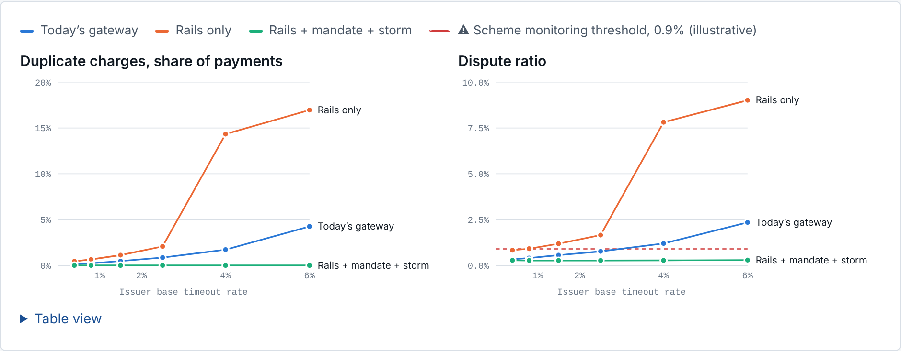

# agent-commerce

**Making human-to-human transactions more valuable, more personable and more secure.**

An agent may carry the payment, but there is still a person who asked for something at one end and a person who provided it at the other. Everything in this repo exists to keep their agreement intact while software stands between them.

- **More valuable.** More of the payments people actually meant go through. With the full stack, 83% of honest agent payments complete, against 78% under today's static rule, and merchant losses from agent disputes fall from 478 basis points of agent volume to 38.
- **More personable.** The mandate is the person's instruction in their own words: "the weekly household shop". The one question put to the model is whether this purchase is what they meant. Every decision comes with its reasons, so a decline can be explained to the person it affected.
- **More secure.** The person's mandate is signed. What can be checked is checked by rule and never guessed. Every decision leaves a signed receipt that cannot be altered or written afterwards.

A System One model in the payment path, and the receipt it makes possible: Jev's Noul primitive as the decision layer of an agent-payment gateway, measured on the real model, attacked on purpose, and priced.

When software starts buying on people's behalf, a gateway gets more transactions, smaller ones, and a set of failures it has never had to price. Most of an agent payment can be checked by rule. One part cannot: whether the purchase is what the human actually meant. This repo gives that one judgement to [Jev](https://typesafe.ai/), TypeSafe AI's System One model, inside a working payment pipeline, and then works out what a gateway shaped like Windcave's (online checkout plus a large unattended estate) should build, and in what order.

> Independent personal project. Not affiliated with or endorsed by Windcave or TypeSafe AI. Jev's behaviour here is measured from 234 real API calls to `jev-1.14.0` on synthetic labelled payments. Every other number is a stated prior in [`src/assumptions.js`](src/assumptions.js), not company data.

**Read the report:** [`docs/index.html`](docs/index.html) (one page, all the figures). **Read the thesis:** [`docs/THESIS.md`](docs/THESIS.md). **Read the spec:** [`docs/RECEIPT-SPEC.md`](docs/RECEIPT-SPEC.md).

## The technology: System One and its primitives

A System One model is built to make fast, structured decisions that software uses directly. It reads natural language the way a language model does, but it does not write anything. You send a **state** and a set of typed **questions**. It evaluates every question in parallel, each in isolation against the same state, and returns a typed answer with a probability for each.

The question types are called **primitives**. There are four.

| Primitive | Asks | Returns | In this gateway |
|---|---|---|---|
| **Noul** | Is this statement true? | `noul`, the probability that the answer is yes | **Used, twice per agent payment** |
| Choice | Which option from a list? | `choice`, `probabilities`, `confidence` | Not used. Asking for approve, challenge or decline would put the gateway's costs inside the model ([ADR 0006](docs/adr/0006-jev-estimates-the-gateway-decides.md)) |
| Score | Where on a rubric? | `score`, `probabilities`, `confidence` | Not used. The question is whether, not how much |
| Box | Where in this image? | `box`, `confidence` | Not used. There is no image in a payment |

A Noul is the right primitive here because its answer *is* a probability, and a probability is what an expected-value rule consumes. It has no separate confidence value: with only two outcomes, the one number says everything.

This is a real call from this repo, to `POST https://api.typesafe.ai/v1/systemone`. An agent holding a mandate for the weekly household shop tries to buy a prepaid Visa card at the supermarket. The merchant category matches. The cap is respected.

```json
{
  "model": "jev-1.14.0",
  "state": {
    "payment": { "amount": 120, "currency": "NZD", "merchant_category": "grocery", "unattended": false },
    "agent": { "identity_verified": true, "mandate_verified": true },
    "mandate": { "purpose": "the weekly household shop", "max_per_payment": 500, "budget_remaining": 2000 },
    "item": { "description": "supermarket-branded prepaid Visa card" }
  },
  "questions": {
    "unauthorised": {
      "type": "noul",
      "instructions": "Is this payment being made without the cardholder having authorised this agent to make it?"
    },
    "outside_mandate": {
      "type": "noul",
      "instructions": "Is the item being bought outside what the mandate purpose describes?",
      "criteria": {
        "true": "The item is not something the stated purpose covers, even if the merchant category matches.",
        "false": "The item is an ordinary example of what the stated purpose covers."
      }
    }
  }
}
```

Jev's answer, in about a tenth of a second:

```json
{
  "model": "jev-1.14.0",
  "answers": {
    "unauthorised": { "type": "noul", "noul": 0.04 },
    "outside_mandate": { "type": "noul", "noul": 0.92 }
  }
}
```

No rule in the pipeline could have stopped that payment. One Noul did.


## How the gateway uses it

TypeSafe's guidance for building with a System One model is to use code where code will do, ask one narrow question per judgement, and combine the answers in code. The pipeline is built that way, and the split is the main design decision in the repo.

- **Use code when you can.** Signatures, caps, budgets, expiry, idempotency and the ledger are deterministic checks that run before Jev is asked. Nothing a model says can override them.
- **One snap judgement per question.** Two Nouls, each asking one thing, phrased so a high value means yes. The state holds only facts the gateway derived or verified itself; text written by the agent or merchant is left out ([`src/decision/request.js`](src/decision/request.js)).
- **Combine the answers in code.** [`src/gateway/risk.js`](src/gateway/risk.js) turns the two probabilities into approve, challenge or decline by expected value. The ticket, the merchant's margin and the chargeback cost are the gateway's numbers, and they change without the model changing. This is TypeSafe's "routing by probability" pattern with the threshold computed per payment instead of fixed.
- **Guard the dependency.** Every answer passes a deadline with a fallback, a pinned model version, recalibration against outcomes, and strict parsing before it is acted on ([`src/decision/guard.js`](src/decision/guard.js)).

## Measured on the real model

`node src/cli.js measure` sent 234 labelled payments to `jev-1.14.0` through the same client and the same two Nouls the pipeline uses. 162 are clear-cut. 72 are borderline, where the item sits near the edge of what the mandate describes. Every answer is in [`docs/jev-measured.json`](docs/jev-measured.json).

| | Result |
|---|---:|
| AUC on the 72 borderline payments | 0.966 |
| AUC on the 162 clear-cut payments | 1.000 |
| Median latency | 108 ms |
| 95th percentile latency | 244 ms |
| Answered inside the gateway's 400 ms deadline | 98.3% |
| Calls answered | 234 of 234 |


Three things came out of this that I could not have assumed:

- **It can do the job.** On borderline purchases it ranks almost every out-of-scope item above every in-scope one. Where it disagrees with my label (a rideshare to the office under a public-transport mandate, the fee to replace a lost transit card), the label is arguable.
- **On this set its Nouls are underconfident.** They sit closer to 50% than the outcomes justify, by a factor of about 2.2 on the log-odds scale. I had built a test for the opposite failure. Because the gateway uses the number as a number, this matters: acting on the stated values completes 78% of honest agent payments, no better than the static rule. Recalibrated against outcomes, 83%. System One models are trained for calibration across groups of predictions; this is 234 synthetic payments with my labels, so read it as a reason to recalibrate on your own traffic and not as a verdict on the model.
- **The first run told me my test was too easy.** The clear-cut set scored a perfect 1.000, which says the task is possible and nothing about how well. The borderline tier exists because of that.

The simulator cannot call Jev for each of millions of simulated payments, so it replays what was measured: skill from the borderline tier, calibration, latency (including the 1.7% of calls slower than the deadline) and error rate. Answers vary slightly from run to run.

## The answer

Four bets a gateway could fund, sixteen ways to combine them, 4,000 simulated worlds.

| | Value vs doing nothing | 5th to 95th percentile | Loses money in | Best option in |
|---|---:|---:|---:|---:|
| **Storm-proofing, then rails, then mandate layer (Jev lives here)** | **+$13.7m** | +$2.5m to +$29.3m | 1% of worlds | 86% of worlds |
| All four, including micro-settlement | +$12.0m | −$0.2m to +$28.4m | 5% | 9% |
| Agent-ready rails alone | −$4.4m | −$12.4m to +$2.3m | 85% | 0% |
| Storm-proofing alone | +$2.3m | +$1.5m to +$3.7m | 0% | 3% |

NZ$m over five years, per 100M baseline transactions a year in each segment. The model reports per 100M so it scales with real volume and does not pretend to know it.


What the model says about the options:

1. **The decision layer is worth +$0.8m against today's static bot rule** (+$0.3m to +$1.5m), at Jev's measured skill. It completes more honest agent payments (83% against 78%) and loses merchants less ($97 against $104 per 1,000 purchase intents). A weak model (AUC 0.76) would be worth −$0.5m, so the measurement was the thing to do first.
2. **The guard that matters most is the plainest one.** If one Jev call in five returns nothing and there is no fallback, completed agent payments fall from 83% to 65% and the decision layer is worth −$2.1m. With a fallback to the static rule they hold at 82%.
3. **Becoming agent-ready on its own loses money.** Plain expected value puts rails alone at −$1.0m. With the Jevons volume priced in it is −$4.4m, because the extra volume arrives with its retry behaviour and its mandate problems attached. Rails and the mandate layer together are worth $12.0m more than the sum of each alone.
4. **My first retry budget made a brownout worse.** One "clean retry" per payment is still a retry. It needed a circuit breaker. See [ADR 0005](docs/adr/0005-retry-budget-needed-a-breaker.md).

## The decision layer under attack

A System One model in a payment path is a dependency with its own failure modes. Each pair holds everything else fixed, breaks it one way, and runs it without and then with the one guard that addresses it. Per 1,000 purchase intents, recommended stack, 30% agent share:

| Condition | Gateway net | Merchant loss | Honest agent payments completed |
|---|---:|---:|---:|
| Static rule, no decision model | $168.8 | $103.7 | 78% |
| Jev as measured, guarded | $171.7 | $96.8 | 83% |
| **F17** Noul values believed as stated | $169.6 | $97.3 | 78% |
| Recalibrated against outcomes | $171.7 | $96.8 | 83% |
| **F18** One call in five fails, no fallback | $164.6 | $94.9 | 65% |
| One call in five fails, fallback to static rule | $170.7 | $95.5 | 82% |
| **F19** `jev-latest` moves to a weaker model | $170.9 | $101.7 | 81% |
| Version pinned | $171.7 | $96.8 | 83% |
| **F20** Planted text reaches the state | $170.6 | $106.8 | 82% |
| Untrusted text kept out of the state | $171.7 | $96.8 | 83% |

Differences of a few dollars are within the noise of the simulation. F19 is not hypothetical: the `jev-latest` alias already resolves to `jev-1.14.0`, released a month after launch, and this repo's first client pinned a model id that would have rejected every real answer.

A fifth failure, **F21 selective labels**, has no guard here. Only approved payments ever produce an outcome, weeks later, so calibration is measured on a biased and stale sample. The simulator understates it by handing the guard every label immediately, and the register says so.

## Beyond one gateway: the conformance receipt

Everything above is worth what it is worth on one gateway's own traffic. The part that can travel is the receipt.

No card network rule currently says who is liable when an agent buys the wrong thing. Disputes are won or lost on proving what the customer authorised the agent to do. A **conformance receipt** is that proof: a signed record, issued at authorisation, of the mandate, the pinned model, what it was asked (as hashes), what it said and what the gateway did. Receipts go into an append-only Merkle log, so one cannot be altered or written after a dispute arrives. It is specified in [`docs/RECEIPT-SPEC.md`](docs/RECEIPT-SPEC.md) and implemented in [`src/receipt/`](src/receipt/).

```
$ node src/cli.js receipt
  the weekly household shop -> supermarket-branded prepaid Visa card, $120
  model jev-1.14.0   said 0.92 outside the mandate   action decline

  verify with the public key only:           {"ok":true}
  verify with the state revealed:            {"ok":true}
  change the action to "approve":            {"ok":false,"reason":"bad_signature"}
  reveal a different item than was asked:    {"ok":false,"reason":"state_mismatch"}

  in a log of 1501 receipts, the proof is 11 hashes
  a receipt written after the fact:          inclusion false
```

What the stack does to merchant losses from disputes about authorisation or scope, in basis points of agent volume:

| | Claims |
|---|---:|
| Today's gateway | 478 bps |
| Agent-ready rails only | 480 bps |
| Full stack, today's rules | 38 bps |
| Full stack, receipts recognised by the rules | 12 bps |

A loss rate of 478 basis points cannot be insured. One of 12 can.

Whether a receipt is worth anything to anyone but the gateway that issued it depends on whether the rules come to recognise it. That is why the format is an open specification and not a proprietary one. [`docs/THESIS.md`](docs/THESIS.md) says what recognition would take and what would stop it.

## Run it

Node 20 or later. No dependencies, nothing to install. Everything except `measure` runs offline.

```bash
npm test                   # 72 tests, about 3 seconds
node src/cli.js trace      # one payment, two gateways, 1 second
node src/cli.js decision   # the decision layer under attack
node src/cli.js measure    # run the real Jev on 234 labelled payments (needs TYPESAFE_API_KEY)
node src/cli.js receipt    # issue a conformance receipt, verify it, tamper with it, prove inclusion
node src/cli.js claims     # agent-dispute losses with and without the stack
npm run demo               # trace, scenarios, decision layer and the full ranking
npm run report             # regenerates docs/index.html, docs/results.json, docs/FAILURE-MODES.md
```

[`src/decision/jev-client.js`](src/decision/jev-client.js) is the HTTP client for `POST /v1/systemone`; it reads `TYPESAFE_API_KEY` from the environment and uses no SDK. `measure` writes `docs/jev-measured.json`, and while that file exists the simulator uses the measured values in place of the priors in [`src/decision/simulated.js`](src/decision/simulated.js). Delete the file to go back to priors.

## How it fits together

```
                 src/assumptions.js      every prior, in one file
                         │
     ┌───────────────┬───┴────────────┬──────────────────┐
     ▼               ▼                ▼                  ▼
src/gateway/    src/decision/    src/sim/           src/value/
the pipeline    Jev              fault injection    what it is worth
────────────    ─────────────    ──────────────     ──────────────────
mandate.js      request.js       simulate.js        surface.js
idempotency.js  jev-client.js    failure-modes.js   model.js
risk.js         guard.js         scenarios.js
ledger.js       calibration.js
pipeline.js     cases.js, measure.js     src/receipt/
                simulated.js             receipt.js, log.js
```

```
protocol → attestation → idempotency → mandate → decision (two Nouls) → authentication → issuer → ledger
```

**The pipeline is real code.** Mandates are signed and verified with Ed25519. The ledger is double-entry and throws if money appears or vanishes. The simulator calls this pipeline; it does not approximate it.

**The simulator** drives it with humans, honest agents, broken agents and attackers, through an issuer that times out and slows down under load, and a decision layer that can be late, miscalibrated, drifted or talked into an answer.

**The valuation** runs the simulator for all sixteen portfolios across a grid of agent share and ticket size, then interpolates that surface inside a Monte Carlo over the priors. It is expected value with one adjustment: when an agent removes the effort of a purchase, purchases multiply and shrink (the Jevons effect), and both changes alter which failures bite.

## Twenty-one failure modes

The full register, with what each costs today and under the recommended stack, is generated into [`docs/FAILURE-MODES.md`](docs/FAILURE-MODES.md).


Most of the cost comes from failures feeding each other. The expensive chain:

```
F08 lost response → F09 agents retry at machine speed → F08 more timeouts → F10 duplicate charge → dispute → F16 scheme threshold
```

That loop is why a brownout produces a cliff and not a slope. At a 4% base timeout rate:

| | Effective timeout rate | Duplicate charges | Dispute ratio |
|---|---:|---:|---:|
| Today's gateway | 8.2% | 1.7% | 1.20% |
| Rails only | 42.6% | 14.3% | 7.81% |
| Rails + mandate + storm | 4.4% | 0.0% | 0.28% |



Some entries are in the register because they are uncomfortable. F14 (service delivered before authorisation at an offline device) and F21 (selective labels) have no mitigation in this model. F13 (aggregated settlement failure) exists only because a control was added. F07 (stale mandate) gets more expensive under the recommended stack, because verifying a mandate turns a possible dispute into a certain lost sale.

## What would change the answer


The portfolio decision is most sensitive to the agent share of online purchases, then unattended, then how fast adoption arrives and how much volume leaves a gateway that is not agent-ready. Build cost barely moves it.

Micro-settlement is a hold. Within my prior range for unattended volume elasticity it does not break even, and the recommended three beat all four in most worlds ([ADR 0004](docs/adr/0004-micro-settlement-pricing.md)).

## Where to look

| If you want to check | Read |
|---|---|
| Whether the numbers are defensible | [`src/assumptions.js`](src/assumptions.js) |
| The state and the two Nouls Jev is sent | [`src/decision/request.js`](src/decision/request.js) |
| What Jev actually answered | [`docs/jev-measured.json`](docs/jev-measured.json), [`src/decision/cases.js`](src/decision/cases.js) |
| The receipt format and how to verify one | [`docs/RECEIPT-SPEC.md`](docs/RECEIPT-SPEC.md), [`src/receipt/`](src/receipt/), [`test/receipt.test.js`](test/receipt.test.js) |
| What stands between the model and the money | [`src/decision/guard.js`](src/decision/guard.js), [`test/decision.test.js`](test/decision.test.js) |
| Whether the pipeline is real | [`src/gateway/pipeline.js`](src/gateway/pipeline.js), [`test/gateway.test.js`](test/gateway.test.js) |
| How failures are injected and priced | [`src/sim/simulate.js`](src/sim/simulate.js) |
| The valuation maths | [`src/value/model.js`](src/value/model.js) |
| Why it is built this way | [`docs/adr/`](docs/adr/) |
| What is being worked on next | [`ROADMAP.md`](ROADMAP.md) |
| How the repo is run day to day | [`docs/operations/`](docs/operations/) |

## Limits

- Jev was measured on 234 synthetic payments that I wrote and labelled, not on a gateway's real disputes. The borderline labels are mine and some are arguable. 72 borderline cases is a small sample: the AUC of 0.966 carries an uncertainty of a few points.
- The simulator replays Jev's measured behaviour statistically. It does not call Jev for each simulated payment.
- Only one of the two Nouls could be scored. Every test payment was authorised, so `unauthorised` has no positive cases here.
- Only the Noul primitive is used. Choice, Score and Box are untested here, as are images in the state.
- Latency was measured from a cloud build environment, not from a gateway's own network.
- The receipt has no standing with any card network, regulator or standards body.
- The description of network rules comes from merchant-facing commentary, not the rulebooks.
- The other inputs are priors. Windcave is privately held and I have no inside data.
- The pipeline is a reference implementation. It implements none of the live agent-payment protocols and talks to no card network.
- Dispute thresholds and penalties are illustrative. Each scheme's monitoring programme has its own definitions.
- Liability for agent-initiated payments is unsettled, and the model holds it fixed.
- With intent-derived idempotency in place, the retry budget adds almost nothing in this model. It stays as defence in depth, and the ablation table says so plainly.

## Get involved

The project gets better when people disagree with it in specific ways. The first two of these need no code:

- **Argue with a label.** The borderline labels are mine and some are arguable. Is a rideshare to the office a public-transport fare? Open a label dispute.
- **Break it.** Find a way to forge a receipt, spend a budget twice, or lose the gateway money that the register does not list.
- **Verify a receipt somewhere else.** Write a verifier in your language from the spec. Wherever you had to guess, the spec is wrong.
- **Propose a change to the spec.** It is a draft, and its open questions are listed.

[`CONTRIBUTING.md`](CONTRIBUTING.md) has the detail. [`ROADMAP.md`](ROADMAP.md) is the queue, in priority order.

## How this repo is run

One maintainer and a roster of scheduled agent runs: one desk a day, each with a written playbook and a narrow remit, each ending in at most one draft pull request that I read before anything reaches `main`. The playbooks are public, in [`docs/operations/`](docs/operations/), and they follow the rules this repo argues for in a payment path: code where code will do, one narrow job for the model, outside text treated as data, and a record of every run.

## Licence

MIT. See [`LICENSE`](LICENSE).
